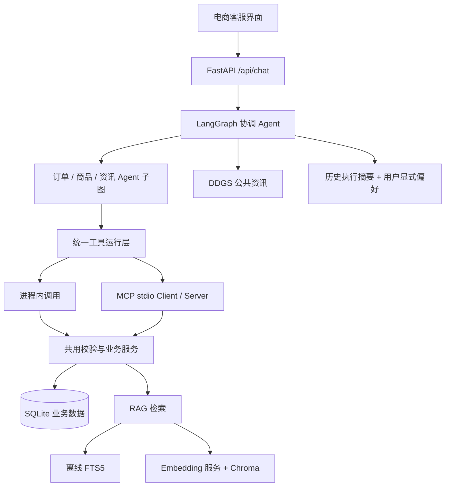

# 电商客服架构与边界

本次将问答应用改为本地单用户电商客服演示。所有订单、支付、库存与退款金额均为合成数据；原有聊天、工具轨迹与用户显式记忆仍保留。第一版完成查询与知识解释，不实际执行交易、支付、退款或工单创建。

## LangGraph 多 Agent

当前已按多 Agent 需求引入 LangGraph：协调 Agent 负责拆解与汇总，订单、商品、资讯 Agent 使用各自的提示词、工具白名单和 ReAct 子图。各 Agent 共享已有 Qwen 服务，按需顺序执行。实现、图结构与预算见 [多 Agent 文档](multi-agent.md)。

会话仍使用 SQLite 保存，未启用 LangGraph checkpointer，不具备执行中途的崩溃恢复或审批恢复。后续加入这类能力时需同时设计恢复接口与动作幂等性。

## 工具契约和权限

`commerce/tools.py` 是业务工具的单一注册表，参数模型同时生成 LLM 与 MCP JSON Schema。只暴露 list_orders、order_detail、catalog_search、knowledge_search；SQL 使用固定模板和参数绑定，拒绝模型提供用户身份或原始 SQL。金额一律整数分。

演示身份由后端 DEMO_USER_ID 固定为 U00001，不从模型或聊天请求接收。不同演示用户的订单有归属过滤。此机制不是登录系统：本机所有调用者共享该演示身份。上线前必须接真实认证，将认证主体绑定到会话和每次工具执行，并隔离会话读写权限。

MCP 使用[官方 Python SDK](https://github.com/modelcontextprotocol/python-sdk)的 v1 稳定接口，依赖限定 `<2`，stdio 标准传输可供外部客户端使用。默认进程内调用减少延迟；COMMERCE_TOOL_TRANSPORT=mcp 时 专业 Agent 每批工具在同一个图节点内建立和关闭 stdio 会话。没有伪造 `/mcp` REST 路由，也没有多开一个监听端口。

## 数据和 RAG

- 演示商品知识位于 fixtures/knowledge/demo.jsonl，全部 synthetic=true；并非 Amazon 数据。SQLite 商品价格、库存与所有业务状态均为模拟值。
- `generate_mock_data.py` 保留为单元测试小样本；主数据管线 `build_dataset.py` 固定随机种子和参考日期，生成 1,000 用户、10,000 订单，并合并公开 PQA，输出版本和校验和。十种订单场景包括运输、签收、延迟、支付失败、取消、退款处理中、全额退款、部分退款、超期与物流异常。商品含缺货场景。
- `import_public.py` 支持本地 CSV、JSONL、JSON 数组和 Parquet，保留来源、license、原始商品 ID。JSON 数组与 Parquet 使用可选流式依赖。统一关联键为 `amazon:{locale}:{source_id}`；PQA 默认地区 us，只有相同地区和相同标识才关联，不能靠标题猜测。
- 商品描述及 QA 导入知识库；订单状态、价格库存始终查 SQL。公开文本中的价格不是当前演示库存/售价。
- 中文 bigram 和英文词项构建 FTS5/BM25，默认无模型下载。它是词法检索，不是语义向量检索，不保证跨语言召回。
- 配置 RAG_BACKEND=chroma 后，使用独立 `/v1/embeddings` 服务生成向量，并以[Chroma 官方接口](https://docs.trychroma.com/docs/collections/add-data)保存向量、片段和 metadata。必须重新导入；不静默降级，不用随机/哈希向量伪装语义嵌入。聊天模型地址不自动作为 Embedding 地址。
- 固定分块与重叠、幂等 upsert、商品与文档类型过滤、引用 ID、来源和许可信息均已实现。模型收到候选片段后检查相关性；rank 不是置信度。首版未增加 reranker，避免无评测依据地堆组件。
- SQLite 文档存储与 Chroma 不支持跨库原子提交；导入异常后可重新导入同一文档修复。切换模式、模型或地址后需重建对应向量索引；不在不同模式下混用旧索引。

## 记忆与失败处理

完整回答及工具结果保留在会话日志。传给模型时附带工具名、成功状态、historical_turn_only 范围；如果该轮所有非记忆工具均失败，则用中性的历史执行记录替换失败文案。混合成功/失败保留回答与执行摘要，不武断认定整个任务失败。

取消搜索专用关键词和强制 web_search。普通改写重试不需要联网，工具选择由当前任务决定。长期记忆只存用户显式要求的稳定偏好；模型接口错误不提交成功对话。旧的无工具轨迹回答不靠文本猜测分类。此机制减少错误复述，但不承诺模型永远正确选工具；执行状态也不等于任务完成状态。

## 验证范围

回归覆盖 SQL 注入参数、用户归属、关系数据与金额、RAG 来源/过滤/重复导入、真实 Chroma 存取、真实 MCP stdio 握手和工具调用、模拟模型 SQL+RAG 多轮流程、连续失败后恢复和无工具重试。

`evaluate_rag.py` 是小型合成语料检索回归，报告 Hit@4/MRR@4；不能据此宣称真实语义检索或客服正确率。Bitext 转换器仅输出支持意图的工具选择评测参考，未训练路由分类器。生产级审批状态机、授权、退款执行、长期记忆自动总结及真实数据规模评测均不在首版内。
