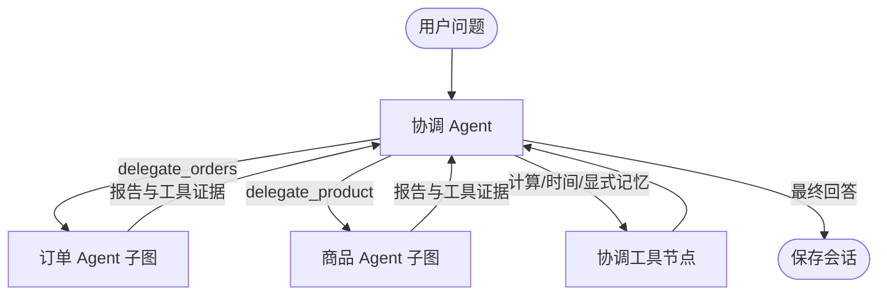

# LangGraph 多 Agent

## 运行结构

图的入口包含可选 Jev 决策节点（默认关闭），末尾包含确定性引用 ID 校验。协调 Agent（supervisor）理解任务、管理显式记忆、委派并汇总；两个专业 Agent 拥有独立提示词和上下文、工具白名单及 LangGraph ReAct 子图。它们共享现有 Qwen/vLLM 模型服务，并不要求加载三份模型。



专业子图均为 `START → model → tools → model → … → END`，由真实 LangGraph `StateGraph`、条件边和 `ainvoke` 执行。外层图负责委派和返回，子图负责专业领域多轮查询。没有在原循环外简单套一层框架，也没有另写关键词路由。

| Agent | 可以执行的工具 |
| --- | --- |
| 协调 | delegate_orders / delegate_product、calculator、current_time、memory_set/list/delete |
| 订单 | list_orders、order_detail、calculator、current_time |
| 商品 | knowledge_search、catalog_search、calculator |

工具白名单在执行时再次校验；模型伪造越权调用也不会执行。专业 Agent 不能改写会话记忆或直接调用其他 Agent。

## 依赖任务如何传递

“我的耳机还没到，能连接 Windows 吗？”通常执行：

1. 协调 Agent 委派订单 Agent；订单子图查询订单与商品 ID。
2. 协调 Agent 得到报告与真实工具 observation，再委派商品 Agent。
3. 商品子图自动收到本轮订单工具返回的商品 ID 候选，查 RAG。
4. 协调 Agent 综合物流记录与商品证据，引用资料并说明缺口。

交接结果含 `summary`、`execution_state`、`evidence`、错误和预算标识。工具执行状态不是任务正确性的保证；协调 Agent 仍须核验原始证据。报告和上下文均有长度预算，可能裁剪早期证据，报告会带 `evidence_truncated` 标识。

当前按顺序委派，匹配已有 vLLM 单并发和任务依赖；同轮多个委派也按调用顺序完成，所有 tool_call 都得到配对结果后才再次调用协调模型。多 Agent 不等于并行执行。若未来增加多并发模型服务，可再对真正独立的任务实现 fan-out/fan-in。

专业 Agent 不接收完整会话历史或长期记忆，只接收协调 Agent 构造的具体子任务。商品 Agent 可额外收到本轮订单工具返回的商品 ID 候选，不会自动复制完整订单记录。自由文本 task 仍由模型生成，应仅包含完成任务所需的信息。

## 预算、失败与持久化

- `AGENT_MAX_STEPS=4`：协调 Agent 最多执行 4 轮调用，随后只能最终回答。
- `AGENT_WORKER_STEPS=3`：每次专业委派最多 3 轮工具，随后只生成报告。
- `AGENT_MAX_HANDOFFS=4`：整次请求最多 4 次专业委派尝试（非法参数也计入）。
- `AGENT_MAX_TOOL_CALLS=16`：所有 Agent 合计最多 16 个工具调用尝试；越权尝试占预算。
- `AGENT_TIMEOUT_SECONDS=600`：整个图共享总时限。`AGENT_CONTEXT_BYTES` 对每次模型请求生效。
- 每次模型响应最多 4 个调用；图还有 recursion_limit 防止错误无限循环。

专业模型服务失败会作为交接错误返回协调 Agent，保留已经成功取得的工具证据；协调 Agent 可继续回答有证据的部分。协调模型错误、全局超时、取消和递归错误不提交本轮历史与记忆，且释放会话锁。

本版**没有配置 LangGraph checkpointer**，图状态仅属于当前请求；用户对话与显式记忆仍由既有 SQLite 事务持久化。进程重启后可以继续对话，但不会恢复执行到一半的图。后续若做人工审批和跨进程继续执行，应再加入 SQLite/Postgres checkpointer、独立 run_id、恢复接口及幂等动作，而不能把一次会话 UUID 直接当成所有运行的恢复凭据。

历史中保留原始回答、工具记录与协作事件。常规模型上下文按预算选取获准的完整问答对，保留原始回答；范围校验拒绝的轮次不回放。执行状态用于会话记录和专业子图交接。

## MCP 与接口兼容

`COMMERCE_TOOL_TRANSPORT=mcp` 仍可用。MCP 会话在一个工具批次的 LangGraph 节点内打开和关闭，避免 AnyIO cancel scope 跨任务退出。相较进程内模式会有子进程开销。

`POST /api/chat` 请求格式不变；响应新增 `agent_events`，每条 `tool_calls` 新增 `agent`。历史记录保存这些字段，旧记录缺少字段仍可显示。页面增加“客服协作记录”，展示委派任务和执行状态，不展示内部思考。

关键实现：`backend/app/agents/roles.py` 定义角色与委派 schema；`graph.py` 定义主图/子图与预算；`context.py` 管理完整协议组；`team_agent.py` 实现异步 Agent；`services/agent.py` 负责会话事务。消息、配置和执行契约见 [框架接口](framework-interfaces.md)。

## 验证

```bash
.venv/bin/python -m pip install -r backend/requirements.txt
PYTHONPATH=backend:. .venv/bin/python -m unittest discover -s backend/tests -v
cd frontend
npm run build
```

测试使用脚本化模型验证真实 LangGraph 执行，包括多 Agent SQL+RAG、批量交接、越权阻断、证据传递、专业模型失败、取消/超时、预算、普通聊天、历史恢复及图节点内真实 MCP stdio 调用。真实模型的任务拆解质量需另外联调评测，不能由 mock 测试推断。

参考：[LangGraph 条件边](https://reference.langchain.com/python/langgraph/graph/state/StateGraph/add_conditional_edges)、[持久化接口](https://reference.langchain.com/python/langgraph.checkpoint)。
